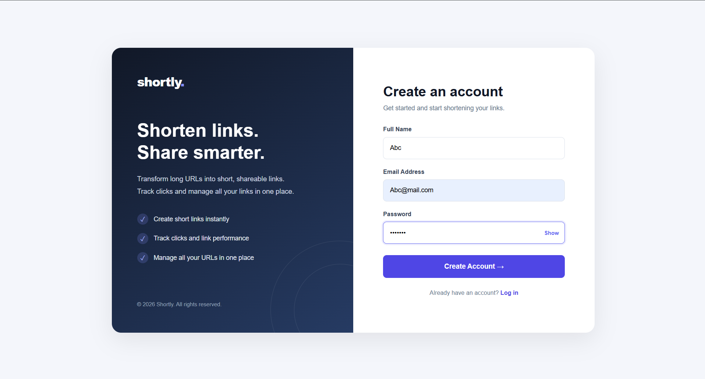
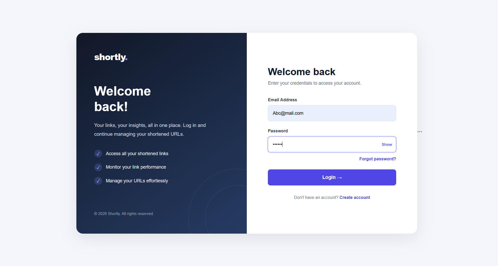
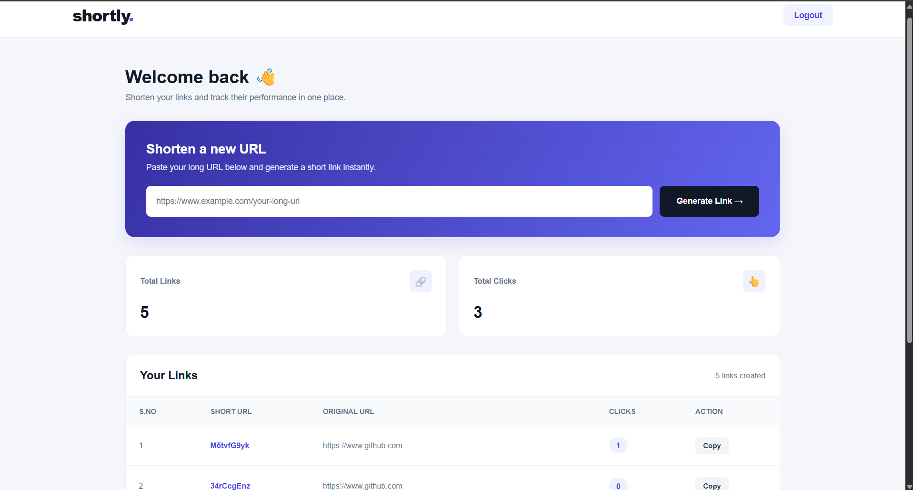

# URL Shortener

A web application that allows users to convert long URLs into short links. Users can create an account, generate short URLs, and manage their previously generated links from their own account.

## About the Project

I built this project to understand how URL shortening services work and to get practical experience with backend development.

While building it, I worked with Express.js, MongoDB, user authentication, middleware, and server-side rendering using EJS.

## Features

- **URL Shortening:** Generate short links from long URLs.
- **URL Redirection:** Redirect users to the original URL using the generated short link.
- **User Authentication:** Users can create an account and log in.
- **URL History:** Users can view the URLs they have generated.
- **User-specific Data:** Each user can access only their own URL history.
- **Visit Tracking:** Store timestamps whenever a shortened URL is accessed.

## Screenshots

### Signup Page


### Login Page


### Dashboard


## Tech Stack

- **Backend:** Node.js, Express.js
- **Database:** MongoDB, Mongoose
- **Frontend:** EJS, HTML, CSS, JavaScript
- **Authentication:** JSON Web Token (JWT), Cookie Parser
- **Other Tools:** ShortID, Nodemon, Dotenv

## Project Structure

```text
url-shortener/
│
├── controllers/
├── middleware/
├── models/
├── routes/
├── service/
├── views/
│
├── connection.js
├── index.js
├── package.json
├── package-lock.json
├── .env.example
├── .gitignore
└── README.md
```

## Getting Started

Follow these steps to run the project on your local machine.

### Prerequisites

- Node.js
- npm
- MongoDB (local installation or MongoDB Atlas)

### 1. Clone the repository

```bash
git clone https://github.com/PrateekTailor/url-shortener.git
```

### 2. Open the project directory

```bash
cd url-shortener
```

### 3. Install dependencies

```bash
npm install
```

### 4. Configure environment variables

Create a `.env` file in the root directory.

Add the following variables:

```env
MONGODB=your_mongodb_connection_string
PORT=8001
```

Replace the MongoDB value with your own local MongoDB or Atlas connection string.

### 5. Start the application

```bash
npm start
```

The application will run at:

```text
http://localhost:8001
```

## How It Works

1. Create an account or log in.
2. Enter the URL you want to shorten.
3. Generate a short link.
4. Open the generated link to visit the original URL.
5. Log in again to view your previously generated URLs.

## Future Improvements

- Deploy the application.
- Add URL analytics and more detailed visit statistics.
- Improve the user interface.

## Author

**Prateek Tailor**